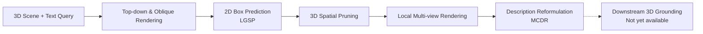

<div align="center">


# PruneGround

### Plug-and-Play Spatial Pruning for 3D Visual Grounding

[](https://2026.emnlp.org/)
[](https://arxiv.org/abs/2606.31148)
[](https://github.com/leduckhai/PruneGround)

**[Duc Cao Dinh](https://caodinhduc.github.io/)<sup>*</sup> · [Khai Le-Duc](https://github.com/leduckhai)<sup>*</sup> · [Florent Draye](https://www.fdraye.com/) · [Chris Ngo](https://sg.linkedin.com/in/chris-ngo-6ba2136/) · [Terry Jingchen Zhang](https://terry-zhang.notion.site/) · [Bernhard Schölkopf](https://is.mpg.de/en/people/bs) · [Zhijing Jin](https://zhijing-jin.com/home/)**

<sub>* Equal contribution</sub>

**Less clutter. More context. Better grounding.**

</div>

---

## ✨ Overview

**PruneGround** is a plug-and-play spatial pruning pipeline for **3D visual grounding**. Given a 3D scene and a natural-language description, it uses a vision-language model (VLM) to identify a promising region in a rendered top-down view, lifts that region back into 3D, and focuses subsequent reasoning on a smaller, more relevant scene.

It then renders **local multi-view observations** of the pruned region and reformulates the description into **target–anchor relations** to provide clearer context for downstream grounding.

> **Core idea:** Instead of asking a grounder to search the entire scene, first narrow down *where to look* and clarify *what to look for*.

## 🔍 Pipeline at a Glance



**Two currently available components:**

- **LGSP — Language-Guided Spatial Pruning:** A VLM predicts a 2D box from scene renderings; the box is projected into 3D to retain a candidate region.
- **MCDR — Multi-View-Conditioned Description Reformulation:** Local views help decompose a free-form query into single-target, single-anchor statements and add visible, relevant anchors.

## 🚧 Release Status

According to the release checklist below, rendering, pruning, and reformulation are implemented; **downstream grounding is not yet marked as available**.

- [x] Top-down and oblique-view rendering
- [x] VLM-based top-view box prediction
- [x] 3D scene pruning
- [x] Local multi-view rendering (MCDR)
- [x] Description reformulation (MCDR)
- [ ] Downstream 3D grounding

## 🚀 Getting Started

### 1. Set up the environment

```bash
conda create -n pruneground python=3.10 -y
conda activate pruneground
pip install -r requirements.txt
```

If your GPU requires a different CUDA-compatible PyTorch build, reinstall `torch` and `torchvision` accordingly. For example, for CUDA 12.8:

```bash
pip install torch torchvision --index-url https://download.pytorch.org/whl/cu128
```

### 2. Prepare ScanNet scenes

Our experiments use **ScanRefer**, **Sr3D**, and **Nr3D**, all based on **ScanNet**. Download ScanNet from the [official website](https://www.scan-net.org/) and place the following files for each scene in your data directory:

```text
examples/data/
├── scene0011_00_vh_clean_2.ply   # Textured mesh
├── scene0011_00.txt              # Contains the axisAlignment matrix
└── scene0011_00_instruction.txt  # Optional: example query
```

### 3. Render the scene

Generate one orthographic top-down view and four oblique RGB-D views:

```bash
python 'render_top&oblique_view.py' \
    --scene_id scene0011_00 \
    --data_dir examples/data \
    --output_dir examples/output
```

This creates:

```text
examples/output/scene0011_00/
├── topview.png
├── metadata.json
└── sideviews/
    ├── view_1_rgb.png
    ├── view_1_depth.png
    ├── ...
    ├── view_4_rgb.png
    └── view_4_depth.png
```

`metadata.json` records scene dimensions (`m`, `n`, `k`, in meters) and the top-view resolution (`w`, `h`, in pixels).

### 4. Predict, prune, and render local views (LGSP)

Run the VLM-based spatial pruning pipeline:

```bash
python LGSP.py \
    --scene_id scene0011_00 \
    --output_dir examples/output \
    --description "This is a single chair nearest the TV" \
    --prompt_style simple
```

**One command performs three steps:**

1. Predict a bounding box in the rendered top-down view.
2. Project the predicted box back into 3D and save the pruned scene.
3. Render two local RGB views of the pruned region for MCDR.

The script also prints the VLM's raw response and writes an annotated `topview_pred.png`.

**LGSP options**

| Flag | Default | Description |
|:--|:--|:--|
| `--model_name` | `Qwen/Qwen2.5-VL-3B-Instruct` | Hugging Face model ID; e.g., use the 7B variant. |
| `--prompt_style` | `full` | `full` uses the paper's Appendix C prompt with top-down and four oblique RGB-D views; `simple` uses a shorter top-down-only prompt. **`simple` is recommended for the 3B model.** |
| `--sideview_max_pixels` | `256*28*28` | Maximum pixels per oblique side view; reduce if you encounter CUDA OOM. The top-down image remains at its native resolution for bounding-box alignment. |
| `--max_new_tokens` | `512` | Maximum number of generated tokens. |
| `--data_dir` | `examples/data` | Directory containing ScanNet `.ply` and `.txt` files. |
| `--pruned_dir` | `examples/pruned` | Destination for pruned `.ply` files. |

> **Prompt tip:** The `full` setting follows the complete prompt described in Appendix C of the paper. For the 3B model, `simple` can be more reliable, since the longer prompt may lead it to predict a full-image box.

### 5. Reformulate the description (MCDR)

MCDR uses the two local images produced by LGSP to restructure the text query:

```bash
python MCDR.py \
    --scene_id scene0011_00 \
    --output_dir examples/output \
    --description "This is a single chair nearest the TV"
```

**Run `LGSP.py` first:** MCDR requires `local_views/local_x.png` and `local_views/local_y.png`.

The result is saved as:

```text
examples/output/scene0011_00/reformulation.json
```

**MCDR options**

| Flag | Default | Description |
|:--|:--|:--|
| `--model_name` | `Qwen/Qwen2.5-VL-3B-Instruct` | Hugging Face model ID. |
| `--max_new_tokens` | `768` | Maximum number of generated tokens. |
| `--sideview_max_pixels` | Unset | Optional pixel cap for local images to reduce GPU memory usage. |

## 🧩 Inside MCDR

`LGSP.py` renders the pruned region for MCDR from the **x- and y-axis directions** of its bounding box, choosing viewpoints closer to the original scene center so the cameras face outward. A slight elevation helps mitigate occlusion; depth maps are not retained. See **Section 3.3 and Appendix B (Figure 5)** of the paper.

The VLM then converts the input into **single-target, single-anchor** statements and supplements them with anchors visible in the local images. See **Appendix C (Figure 7)** for the reformulation prompt.

The resulting JSON contains:

| Field | Meaning |
|:--|:--|
| `target` | Name of the target object. |
| `anchors` | Anchor objects mentioned in the original description. |
| `anchors_visual` | Additional anchors seen in local views but not mentioned in the input. |
| `target_properties` / `augmented_target_properties` | Explicit and visually inferred target attributes. |
| `utterances` / `augmented_utterances` | Structured target–anchor statements. |
| `reformulated_description` | Flattened text intended for the downstream grounder. |
| `raw` | Unparsed VLM output. |

## 📁 Where to Find the Outputs

After the LGSP and MCDR commands, the key artifacts are:

```text
examples/
├── output/
│   └── scene0011_00/
│       ├── topview.png
│       ├── topview_pred.png
│       ├── metadata.json
│       ├── sideviews/
│       │   └── ...
│       ├── local_views/
│       │   ├── local_x.png
│       │   └── local_y.png
│       └── reformulation.json
└── pruned/
    └── scene0011_00.ply
```

## 📄 Paper & Citation

**[PruneGround: Plug-and-Play Spatial Pruning for 3D Visual Grounding](https://arxiv.org/abs/2606.31148)**  
**EMNLP 2026 — Oral Presentation**

[Read the paper](https://arxiv.org/pdf/2606.31148) · [View the arXiv abstract](https://arxiv.org/abs/2606.31148) · [GitHub repository](https://github.com/leduckhai/PruneGround)

Conference proceedings citation will be added when available.

---

<div align="center">

**Prune the scene. Refine the language. Focus the grounding.**

</div>
